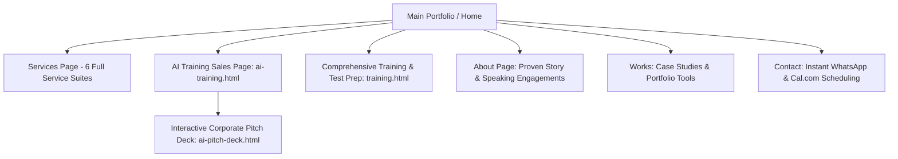

# Implementation Plan: Copywriting Overhaul, Expanded Service Suites, Sales Landing Pages & Pitch Deck

> **Goal:** Transform the website's tone from academic into simple, punchy, high-converting direct-response sales copy, expand Alfred's service offers to fully showcase Writing & Editing (business profiles, pitch decks, CVs, copywriting, ghostwriting), Video & Motion Design (promo videos, company intros), Speaking & Keynotes, and Universal Training (AI, Web, Writing, Test Prep), backed by dedicated landing pages (`ai-training.html`, `training.html`), a web-based corporate pitch deck (`ai-pitch-deck.html`), and Nigerian-market realistic pricing.

---

## 1. Context & User Vision (Incorporating Latest Voice Note)

You have approved the general direction and requested that we add the following essential service pillars to the transformation:

### 1.1 Complete Writing & Editing Suite
- **Business Writing & Corporate Collateral:**
  - Company Profile Documents (written + beautifully designed on-brand)
  - Investor Pitch Decks (copywriting + graphic design)
  - Business Proposals, Grant Applications & Executive Summaries
  - Website Copywriting (high-converting landing page copy)
- **Professional Career Writing:**
  - Executive CV & Resume Revamp
  - LinkedIn Profile Optimization & Executive Bio
  - Cover Letters & Professional Portfolios
- **Content Writing & Thought Leadership:**
  - High-impact Copywriting (sales pages, email sequences, ad copy)
  - Ghostwriting for Founders & Executives (LinkedIn posts, articles, thought-leadership essays)
- **Academic & Admissions Writing:**
  - Statements of Purpose (SOP), Personal Statements, Study Plans for UK, US, Canada & EU universities
  - Research Proposals & Academic Editing

### 1.2 Creative Video Production & Motion Design
- Company Introduction Videos
- Promotional & Explainer Videos for brands, SMEs, and startups
- Motion Graphics & Animated Brand Assets
- Video Editing for YouTube, Social Media, and Corporate Campaigns

### 1.3 Keynote & Public Speaking Engagements
- Open for invitations as a Speaker, Panelist, or Workshop Facilitator
- Topics:
  - *Practical AI for African Businesses & Professionals*
  - *Building High-Income Tech & Digital Careers*
  - *Cracking Global Admissions & Scholarships (IELTS/GRE/Visas)*
  - *Digital Product Architecture & Web Engineering*
- Dedicated "Invite Alfred to Speak" booking flow and speaker bio.

### 1.4 Pricing Calibration for the Nigerian Corporate & Professional Market
- Transparent, realistic, and highly compelling pricing in Nigerian Naira (₦) with USD ($) equivalents for international clients.
- Tiered packages for individuals, startups/SMEs, and corporate enterprises.

---

## 2. Updated Architecture & Site Map

---

## 3. Detailed Service Breakdown & Nigerian Market Pricing

| Service Suite | Offerings Included | Typical Nigerian Market Pricing |
| :--- | :--- | :--- |
| **01. Corporate AI Training & Automation** | Team AI workshops, custom ChatGPT/Claude workflows, 1-on-1 executive coaching, productivity automation | **Executive 1-Day:** ₦250k / $250 **Team 2-Week Accelerator:** ₦650k / $650 **Enterprise Custom:** Custom Scope |
| **02. Full-Cycle Web Development** | High-speed business websites, custom landing pages, web applications, sub-100ms performance | **Starter Business Site:** ₦180k / $200 **Growth Corporate Web App:** ₦450k / $500 **Bespoke Platform:** ₦850k+ / $950+ |
| **03. Business Writing & Pitch Decks** | Company Profile (copy + design), Investor Pitch Decks, Business Proposals, Website Copywriting | **Company Profile (Copy+Design):** ₦120k / $140 **Investor Pitch Deck:** ₦180k / $200 **Website Full Copy:** ₦95k / $110 |
| **04. Professional Career Writing** | Executive CV / Resume Revamp, LinkedIn Optimization, Executive Bios, Cover Letters | **Career Starter (CV + Letter):** ₦35k / $40 **Executive Package (CV + LinkedIn):** ₦65k / $75 |
| **05. Video Production & Motion Design** | Promo videos, company intro videos, motion graphics, video editing for campaigns | **Social Promo / Reel:** ₦45k / $50 **Company Intro Video:** ₦120k / $140 **Full Campaign Suite:** ₦280k / $320 |
| **06. Skills Coaching & Test Prep** | IELTS 8.5+ Intensive, TOEFL iBT, GRE, Web Dev Mentorship, Academic SOP Coaching | **Test Prep Intensive (4-Wk):** ₦120k / $140 **SOP / Admissions Mentorship:** ₦85k / $100 **1-on-1 Web Mentorship:** ₦150k / $175 |
| **07. Keynotes & Public Speaking** | University symposiums, tech panels, corporate conferences, youth summits | **Non-Profit / Student Summits:** Honorarium **Corporate / Tech Keynotes:** Custom Engagement |

---

## 4. Phased Implementation Steps

### Phase 1: Site-Wide Copywriting & Tone Transformation
* **Goal:** Eliminate academic jargon and replace with high-converting, benefit-driven sales copy written in simple, persuasive English.
* **Files to Update:**
  - `services.html`:
    - Re-title header: *"Practical Services & Transparent Pricing — Built to Grow Your Business, Brand, and Career."*
    - Expand practices to reflect the full six service pillars: AI Training, Web Development, Business Writing & Decks, Professional Career Writing, Video/Motion Design, and Test Prep/Mentorship.
    - Add clear, realistic pricing cards with Nigerian Naira (₦) and USD ($).
    - Simplify the FAQ section into everyday business questions with direct answers.
  - `about.html`:
    - Replace *"Humanistic Rigor"* with *"Proven Strategy. Real-World Execution. Zero Fluff."*
    - Add a dedicated **Keynotes & Public Speaking** card: speaker topics, past audiences, and an *"Invite Alfred to Speak"* CTA button.
  - `index.html`:
    - Update hero copy to showcase the complete value proposition: Web Architect, Corporate AI Trainer, Professional Writer & Speaker.
    - Update service highlights and trust metrics.
  - `contact.html`:
    - Update inquiry form options to include: Corporate AI Training, Business Website, Pitch Deck / Company Profile, CV & Career Writing, Video/Motion, Speaking Engagement.

---

### Phase 2: Dedicated Sales Landing Page — Corporate & SME AI Training (`ai-training.html`)
* **Goal:** A dedicated sales landing page specifically tailored for Nigerian and international SMEs, corporate leaders, and HR managers.
* **Structure:**
  1. **Hero:** *"Train Your Workforce to Use Practical AI — Save 15+ Hours Every Week and Increase Output by 3x."*
  2. **The Problem:** Companies wasting money on generic tools while employees struggle with vague prompting and fear of AI.
  3. **The 4-Pillar AI Curriculum:**
     - Module 1: Daily Task Automation (Email, reports, scheduling, meeting notes).
     - Module 2: Research & Document Synthesis (Turning long PDFs into executive insights in seconds).
     - Module 3: Marketing & Sales Copy Generation (Ad copy, client proposals, follow-ups).
     - Module 4: Corporate Data Security & Safe AI Protocols.
  4. **Training Delivery Formats:** 1-Day Executive Intensive, 2-Week Team Accelerator, 1-on-1 Leadership Coaching.
  5. **Corporate ROI Proof:** How a 10-person team saves 400+ productive work hours every month.
  6. **Interactive CTA:** Buttons to *"View Corporate Pitch Deck ↗"* and *"Book a Free Discovery Call"*.
  7. **Pricing & Packages:** Clear Nigerian corporate pricing tiers.

---

### Phase 3: Interactive Web-Based Enterprise Pitch Deck (`ai-pitch-deck.html`)
* **Goal:** A sleek, interactive slide presentation that corporate executives can open in a browser, present in boardroom meetings, or click through slide-by-slide.
* **Features:**
  - **Slide 1:** Title — *Corporate AI Acceleration: Practical Workforce Upskilling for 2026*.
  - **Slide 2:** The Challenge — Why traditional workflows are costing Nigerian companies millions in wasted hours.
  - **Slide 3:** The Alfred E. Williams Solution — Real-world, hands-on, workflow-integrated AI training.
  - **Slide 4:** The 4-Module Curriculum & Hands-on Deliverables.
  - **Slide 5:** Delivery Formats — On-site workshops, hybrid cohorts, and executive 1-on-1s.
  - **Slide 6:** Investment & Corporate Engagement Tiers (₦250k - ₦650k+).
  - **Slide 7:** Facilitator Credentials & Track Record.
  - **Slide 8:** Next Steps & Board Approval Checklist with direct *"Schedule Discovery Session"* button.
  - **Interactive Controls:** Left/Right keyboard arrows, touch swipe, slide indicator dots, full-screen mode, printable/PDF-ready.

---

### Phase 4: Comprehensive Skills, Writing & Test Prep Hub (`training.html`)
* **Goal:** A dedicated hub for individual learners, students, and professionals.
* **Categories Covered:**
  - **Test Prep:** IELTS 8.5+ Intensive, TOEFL iBT, GRE, SAT, and US Visa mock interviews.
  - **Tech Skills:** Frontend Web Development Bootcamp (HTML/CSS/JS).
  - **Writing & Careers:** Statement of Purpose (SOP) Mentorship, Executive CV & LinkedIn Makeovers.
  - **Practical AI for Freelancers:** Using AI to double freelance output and land international gigs.
* **Features:** Syllabus accordion, student guarantees, transparent dual-currency fees (₦/$) and 1-click WhatsApp enrollment.

---

### Phase 5: Navigation, Cross-Linking & Global Consistency
* Update global navbar and mobile menu across all pages:
  - Add **`Training & Programs`** dropdown:
    - *Corporate AI Training* (`ai-training.html`)
    - *Interactive Pitch Deck* (`ai-pitch-deck.html`)
    - *Skills & Test Prep* (`training.html`)
  - Ensure links to Writing, Video, and Speaking are prominent and clearly labeled.
* Update footer on all pages with quick links to these new offerings.

---

### Phase 6: Browser Testing & Verification
* Open test server (`http://localhost:8080`).
* Validate all pages on Desktop (1280px+), Tablet (768px), and Mobile (375px).
* Test keyboard arrow navigation and full-screen mode on `ai-pitch-deck.html`.
* Verify that all WhatsApp buttons launch with pre-filled, professional messages.

---

## 5. Ready for Execution

Review this plan and click **"Proceed"** (or reply to confirm) when you're ready for implementation to begin!
